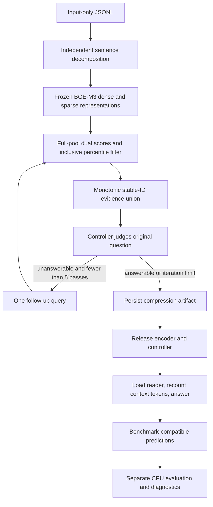

# Architecture and compatibility audit

The existing `benchmark.py`, `diagnostics.py`, and `test_benchmark.py` are unchanged by this implementation. The prepared manifest records 30 smoke examples, 150 calibration examples, and 2,417 evaluation examples. Input rows contain only `id`, `question`, and paragraphs with `idx`, `title`, and `paragraph_text`. Gold has additional annotations and is forbidden in ordinary inference. Original files and splits were inspected without running inference on them.

The existing diagnostic validator requires a complete segment catalog, consecutive iteration indices, real retrieval selections before accumulation, the final accumulated selection, and paragraph predictions matching final evidence provenance. Full rankings contain every candidate exactly once and are sorted by descending dual score. Raw and Oracle omit traces. A failed controller never produces an invented judgment; debugging traces are kept separately and the failure prediction has no `iteration_trace`.

## Component boundaries

| Module | Responsibility |
| --- | --- |
| `config.py`, `schemas.py` | Typed settings, identities, inference-only data structures |
| `dataset.py`, `oracle.py` | Strict input loader; isolated gold paragraph selector |
| `decomposition.py` | Non-overlapping spaCy sentence spans with source character offsets |
| `embedding.py` | Official BGE-M3 model forward and token-weight extraction; explicit synthetic encoder |
| `relevance.py`, `filtering.py` | Dense dot product, weighted sparse inner product, direct weighted sum, linear global percentile |
| `accumulation.py`, `stopping.py` | Stable monotonic union and answerability/five-pass termination |
| `controller.py`, `reader.py`, `prompt_builder.py` | External prompts, strict controller JSON, separate short-answer reader |
| `backends/` | Lazy Transformers, compatible HTTP endpoint, and scripted mocks |
| `pipeline.py` | Compression and reading independently of file IO |
| `artifacts.py`, `serialization.py`, `experiment.py` | Validation, resumable persistence, lifecycle and CLI integration |
| `telemetry.py`, `tokenization.py`, `cloud.py` | Timings, usage, optional reference tokenizer, notebook setup helpers |

Every query searches all original sentence representations, including previously retained sentences. Query representations are recomputed; candidate representations are encoded once per sample. Neither novelty nor repeated queries influence stopping. There is no external retrieval, pruning, normalization of score distributions, query fusion, neighbor expansion, or extra verifier.

## Staged artifacts and identity

`compression_results.jsonl` contains the original question, raw rendered context, complete sentence catalog, selected IDs, unchanged compressed context, source paragraph IDs, complete successful iteration traces, controller calls including raw outputs, all scores when full traces are enabled, thresholds, costs, errors, dataset hash, compression contract hash, and a record checksum.

The compression contract includes the method, dataset identity in the enclosing manifest, encoder and controller configurations (including revisions, quantization, precision and placement), controller prompt hash, decomposition, score/filter settings, iteration budget, context format, and implementation source hash. Reader settings and reader prompt are excluded. On reading, both the whole artifact hash and each record checksum are verified, the sample-ID set must match its manifest, and source context/provenance is checked against the original input-only file before a reader loads.

Reader runs have their own configuration, prompt/tokenizer identity, artifact file hash, and sample subset in their resume contract. They load neither controller nor encoder. The original compression context and measured compression cost are preserved in every reader experiment. Prediction records carry the compression information plus the answer, reader usage and combined algorithm time.

The CLI `both` mode finishes and closes compression before reading. A `BackendPool` also permits explicit sharing by applications that intentionally keep identical backend configurations live; separate processes in the notebook are the default for GPU memory isolation.

## Checkpointing and coverage

Each completed record is appended as UTF-8 JSONL, flushed, and fsynced. Metadata uses atomic replacement. A process lock protects each output directory; the operating system releases it after a crash. Resume skips completed IDs, including explicit failure records, and checks settings/data/subset identities. To retry failed IDs, create a new explicitly selected run rather than appending duplicates.

Only an incomplete final JSONL record can be quarantined and removed during resume. Complete trailing objects missing just their newline are preserved and terminated. Duplicate IDs, malformed newline-terminated rows and interior corruption fail. Artifacts from an interrupted compression run must be resumed to completion for their selected subset before reading. No active artifact is consumed while another process is writing it.

Run status is `running`, `interrupted`, `partial`, or `complete`. `selected_subset_complete` and `complete_split` are separate: a finished two-sample run is still a partial split. Complete coverage includes logged failures; it does not mean all model calls succeeded. The evaluation wrapper requires explicit `--allow-partial` and writes matching gold subsets in the report directory. Existing report directories are preserved. Merge accepts only finished, disjoint shards with matching settings and dataset identity; it rejects duplicates.

## Failure and measurement boundaries

Setup errors (missing device, gated checkpoint, unsupported precision, missing BGE sparse head) stop the stage and mark it interrupted. Per-sample failures produce an empty final answer, `predicted_answerable=false`, and an error log. A controller parse failure has no diagnostic trace; its raw responses and completed states remain in debugging fields. A valid compression trace remains usable for diagnostics if only the reader fails.

The configured `answerable_follow_up_policy` separates output handling from research decisions. Default `normalize_unused` accepts a valid explicit answerable label whose follow-up is a string, normalizes that unused field to null, and logs the formatting violation in `controller_calls[].format_warnings`, `iteration_trace[].controller_format_warnings`, and `controller_format_warning_count`. It preserves raw replies and the actual parsed decision. `strict` retains null-only rejection. Both policies reject malformed/missing fields and invalid answerability labels. Neither policy changes the sufficiency label, generates another query on an answerable branch, or makes repair calls.

Per-sample algorithm time excludes model initialization and serialization. `total_seconds` adds actual `compression_seconds` and `reader_seconds`, even across separate sessions. Loading times, dependency versions, device memory and serialization time are reported separately in run metadata. See the reproduction notes for the token-counting and error conventions.
